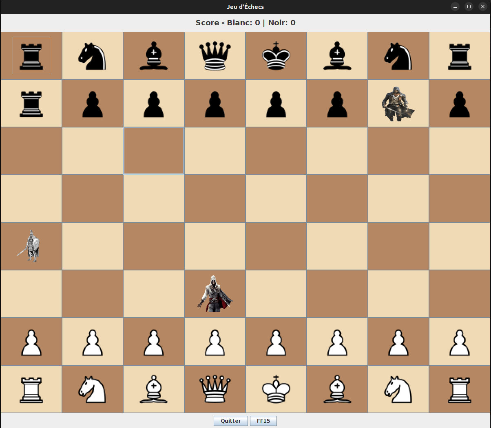

# ♟️ Jeu d'Échecs Personnalisé en Java

Bienvenue dans un projet de jeu d’échecs en Java avec une **interface graphique**, un **mode terminal** et la possibilité d'ajouter des **pièces personnalisées** via des fichiers JSON. 
Vous pouvez jouer avec les règles classiques ou inventer vos propres pièces !

## 🧑‍💻 Auteur

  - Baptiste Joubert

---

## 🧠 Fonctionnalités

  - ✅ Jeu d’échecs en mode console ou mode graphique (Swing GUI)

  -  ♟️ Système de pièces personnalisées via des fichiers JSON

  - 👑 Pièces de base : Roi, Reine, Cavalier, Tour, Fou, Pion

  -  🎯 Prise en compte de la promotion, du tour par tour, des échecs

  - 🚨 Bouton de forfait, suivi du score en GUI
  
  -  🔁 Relancer une partie après un forfait en mode personnalisé GUI

  - 🧠 Intelligence Artificielle basée sur MinMax pour jouer automatiquement

  - 🧪 Tests unitaires complets avec JUnit pour assurer la stabilité du projet

---

## ▶️ Lancer le projet avec Maven

### ✅ Prérequis
- Java 8 ou plus
- [Maven](https://maven.apache.org/) installé (assure-toi d’avoir la commande `mvn` disponible dans ton terminal)

---

### 📦 Compilation & Tests avec Maven

Le projet utilise **Maven** pour gérer les dépendances (comme `org.json` et JUnit) et simplifier la compilation, l’exécution et le packaging.

#### 🔨 Compiler le projet :

```bash
mvn compile
```

#### 🧪 Lancer les tests unitaires :

```bash
mvn test
```

#### 📦 Générer le .jar exécutable :

```bash
mvn package
```

Le fichier .jar sera généré dans le dossier target/. 
Tu peux ensuite le lancer avec :

#### ▶️ Lancer l'archive executable

```bash
java -jar target/echecs-1.0.jar
```
---

## 🎮 Choisissez votre mode :

  -  Mode Classique terminal (pièces de base)

  -  Mode Personnalisé terminal (ajoutez vos pièces)

  -  Mode Classique GUI

  -  Mode Personnalisé GUI

Tout les modes peuvent être joués en 1 ou 2 joueurs

---

## 🔧 Ajouter une pièce personnalisée

Les pièces personnalisées sont des fichiers .json placés dans le dossier :

```bash
./src/main/resources/projet/pieces
```

### ✏️ Exemple de JSON (Dame.json)

```json
{
    "name": "Sentinelle",
    "unicodeWhite": "🛡️",
    "unicodeBlack": "🛡️",
    "imageWhite": "projet/white_guard.png",
    "imageBlack": "projet/black_guard.png",
    "movesWhite": [
        [1, 0], [-1, 0], [0, 1], [0, -1]
    ],
    "movesBlack": [
        [1, 0], [-1, 0], [0, 1], [0, -1]
    ],
    "capturesWhite": [],
    "capturesBlack": [],
    "deplacementLong": true,
    "peutSauter": false
}
```

## 🧪 Tests unitaires

Le projet est couvert par des tests unitaires JUnit :

  - Validation des déplacements

  - Détection des coups légaux en cas d’échec

  - Vérification de l’évaluation des plateaux de jeu

Il n'y a pour l'instant pas de tests pour l'IA


## 🤖 Intelligence Artificielle (IA)

Une IA basée sur l'algorithme MinMax est intégrée :

  - Choix du meilleur coup possible selon une évaluation personnalisée du plateau

  - Prise en compte des captures, échecs, mat et menaces

Jouez contre l’ordinateur si vous voulez vous tester ! 


---

## 📦 Librairies utilisées

✅ Seule dépendance externe requise, pour le parsing JSON, j'ai utilisé `org.json`

---

## 🎮 Aperçu du jeu

Voici un aperçu du mode graphique (GUI) avec les pièces affichées sur l’échiquier :




## 🌈 Idées de pièces personnalisées

    🐉 Un dragon qui vole sur les cases horizontales et verticales

    👣 Un fantôme qui peut sauter par-dessus toutes les pièces

Tu es libre de créer tes propres règles via les vecteurs de mouvements dans le JSON !
